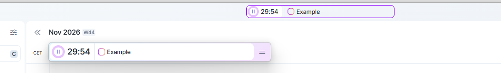
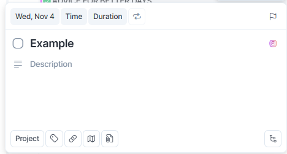

# Visual reference and audit

The owner supplied the following two positive reference images for the compact interaction brief. The brief groups examples 4, 6 and 7 as positive and 1, 2, 3 and 5 as negative. The two supplied images are identified here by content because they do not carry individual figure numbers.

The timer reference keeps pause, countdown and the linked task on one horizontal axis. The expanded strip exposes an extra action at its trailing edge. LifeOS uses one active strip, shown either in the header or floating above the workspace. The same task and countdown remain visible.

The task reference puts date and priority near the top, the editable title in the center, and secondary actions along the edge. The prototype opens beside the task list and gives the project and Create actions a stable footer. Time and duration live in Schedule. The creation prompt asks for fewer initial controls than the reference's edit view.

## Negative examples and audit

The brief describes 1, 2, 3 and 5 as all-fields-visible screens. Their individual image files were not included with the new captures. The following audit records observable behavior in LifeOS before this pilot.

| Surface | Previous interaction | Review decision |
| --- | --- | --- |
| New task / Edit task | One modal simultaneously showed title, project, date, time, duration, priority, description, tags, location, recurrence, attachment and subtasks. | Prototype the local composer and hide secondary fields. |
| Focus timer | Starting or pausing required opening a form, choosing an action and saving. | One click plays or pauses. Overflow handles infrequent actions. |
| Project Studio | Name, folder, color, stage, linked skill and file were always present. | Next review candidate, pending owner approval. |
| Task cards and settings | Task lists exposed child controls and settings opened general forms. | Keep outside the two-prototype pilot. |

Use reference images to review hierarchy, density, and interaction; retain LifeOS project images, theme tokens, accessibility and existing data.
